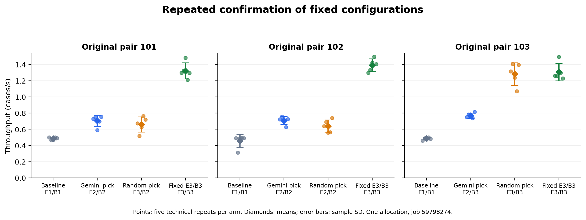

# Exhaustive configuration and contract-cost results

**The bounded runtime completed and audited both new studies. E3/B3 was the
measured best configuration in the exhaustive sweep. The historical sessions
do not demonstrate a Gemini selection advantage. Direct contract work was
measurable, averaging 145.698 ms; an "under 1%" overhead claim is not supported.**

## Completed studies and provenance

| Study | Job | Compute node | Measured trials | Scientific checks | Slurm elapsed | Exit |
| --- | --- | --- | ---: | --- | --- | --- |
| Nine-configuration landscape | 60056838 | nid004436 | 45 | 45/45 passed | 00:05:30 | 0:0 |
| Bare/contract comparison | 60080557 | nid004384 | 20 | 20/20 passed | 00:02:37 | 0:0 |

Each study also ran one excluded warmup. Every trial and warmup comprised three
independent water 6-31g SCF calculations. Both studies used Python 3.10.19,
Ray 2.54.0, and the verified image ID
`60433343d8c7b7d2d308dc7965f479f456670bfc4c8059a3fdde624e862b6d16`.
The published source snapshots and scientific outputs pass the evidence audits.
No Gemini decisions or API requests were needed for these two fixed studies.

The landscape plan was committed in `bcd414e` before its job; the overhead plan
was committed in `362afb0` before its job. Their plan digests are:

- Landscape: `6ee028556344c4da4e975258a21d72241ed05873edcb12574d5e997d03871746`.
- Overhead: `f4be8dc811f8c00e04813911bd49c6523bf2931ba0e12db064801ffaf7a62ad7`.

The driver session timers, including cleanup, recorded 302.170 and 129.545 seconds,
respectively. Those timers start after preliminary source checking and snapshot
creation; they are not the Slurm allocation elapsed times in the table.

Evidence: [landscape session](../results/landscape-60056838-1792534862156509396/),
[landscape analysis](../results/landscape-analysis-60056838/),
[overhead session](../results/overhead-60080557-1792566365046003642/), and
[overhead analysis](../results/overhead-analysis-60080557/). Each session includes
its Slurm accounting record, plan, provenance, source snapshots, state, raw SCF
text, measurement files, and validation result. NWChem scratch databases are not
needed to rerun the audits.

## Exhaustive empirical ranking

All nine executor/batch-size combinations were measured five times in five
independently shuffled repeat blocks in one allocation. Entries below are
arithmetic mean throughput and sample standard deviation over those five trials.

| Rank by mean | Configuration | Mean (cases/s) | Sample SD (cases/s) | Reference regret (%) |
| ---: | --- | ---: | ---: | ---: |
| 1 | E3/B3 | 1.547847 | 0.177391 | 0.00 |
| 2 | E2/B3 | 0.833230 | 0.023793 | 46.17 |
| 3 | E2/B2 | 0.767366 | 0.136579 | 50.42 |
| 4 | E3/B2 | 0.733537 | 0.096011 | 52.61 |
| 5 | E2/B1 | 0.569329 | 0.038151 | 63.22 |
| 6 | E1/B1 | 0.558422 | 0.052450 | 63.92 |
| 7 | E1/B3 | 0.529955 | 0.042588 | 65.76 |
| 8 | E3/B1 | 0.509861 | 0.035981 | 67.06 |
| 9 | E1/B2 | 0.508482 | 0.034020 | 67.15 |

Reference regret for configuration c is
`100 * (best_reference_mean - reference_mean(c)) / best_reference_mean`.
E3/B3 was the highest-mean configuration in this allocation. The exact ordering
of the remaining configurations should not be interpreted as statistically
established; several distributions overlap and there are only five repeat
blocks. The report includes seeded block-bootstrap intervals and resampling
top fractions, not probabilities of a universally optimal configuration.

This reference measures the existing three-case scheduling space. It is not an
evaluation of memory policies, within-application adaptation, or larger molecules.
See [all trials](../results/landscape-analysis-60056838/trials.csv) and
[ranking and uncertainty](../results/landscape-analysis-60056838/landscape.csv).

## Retrospective policy reference regret

Each historical session's recorded best configuration, retaining its baseline as
a candidate, is mapped onto the new reference landscape. The historical choice
is not changed after seeing the sweep. Old throughput is never subtracted from
new throughput. A visit means a scientifically successful measurement, including
the baseline where applicable.

| Source job | Policy | Sessions | Selected E3/B3 | Visited E3/B3 | Mean reference regret (%) |
| --- | --- | ---: | ---: | ---: | ---: |
| 58835485 | Gemini | 3 | 0/3 | 0/3 | 49.01 |
| 58835485 | Random | 3 | 1/3 | 1/3 | 34.34 |
| 59936561 | Gemini | 3 | 0/3 | 0/3 | 50.42 |
| 59936561 | Random | 3 | 1/3 | 1/3 | 33.62 |

Across six sessions per policy, Gemini selected and visited E3/B3 in 0/6, while
random did so in 2/6. Both random hits are seed 103; repeated seeds reuse random
configuration sequences across jobs. There are two comparison allocation blocks,
not six independent allocation replicates or six independent random seeds.
The new reference was collected in a third allocation under a pinned image and
changed instrumentation. These are descriptive retrospective reference regrets,
not measurements of the optimum that existed during each historical search.

The [session-level regret table](../results/landscape-analysis-60056838/regret.csv)
also reports the best reference configuration visited separately from the final
recommended configuration. A stronger future design would collect a reference
sweep alongside new policy sessions within each allocation.

## Measured contract cost

Ten pairs compared the same E2/B2 workload in one warmed Ray actor, with the
first arm randomized and the order then alternating across pairs. Each arm was
executed separately. Both paths retain the harness's scientific checks; the
contract path additionally admits the action, validates original outputs, hashes
artifacts, writes state and receipts, and exports the trajectory.

| Metric | Mean | Sample SD | Observations |
| --- | ---: | ---: | ---: |
| Bare Ray call roundtrip (s) | 4.306110 | 0.407260 | 10 |
| Contract Ray call roundtrip (s) | 4.497267 | 0.357344 | 10 |
| Paired difference, contract minus bare (s) | 0.191157 | 0.609739 | 10 |
| Paired relative increase (%) | 5.355912 | 13.536398 percentage points | 10 |
| Directly instrumented component sum (ms) | 145.698 | 29.442 | 10 |
| Component share of contract-worker time (%) | 3.248129 | 0.610977 percentage points | 10 |

The 5.355912% figure is the mean of the ten within-pair relative differences,
`100 * (contract_i / bare_i - 1)`, not the ratio of the two mean times. Similarly,
3.248129% is the mean of the per-trial component shares. The absolute paired
differences ranged from -0.964293 to +0.980242 seconds; negative differences were
retained. The variation is large relative to the mean difference, so these data
do not establish a precise total-call penalty or an "under 1%" bound.

| Direct component | Mean (ms) |
| --- | ---: |
| Admission, including lock wait | 9.187 |
| Reservation writes | 21.790 |
| Completion and receipt writes | 26.843 |
| Trajectory export | 31.187 |
| Scientific validation, including reads | 56.620 |
| Hashing loaded artifact bytes | 0.071 |

Hashing time excludes the input reads already charged to validation. Direct
components are contained within the worker interval and must not be added to
the total call time again. Their sum excludes the profile-journal write and
lock release, which are included in whole-call timing. Session creation/history
setup and the common post-timing evidence audit are outside the measured call.
One-time source verification took 10.822 ms and is reported separately. Ray
startup, image checks, and warmup are also outside the per-call comparison.
This measures the instrumented runtime contract; it does not include Gemini
reasoning or MCP transport costs and is not a monetary-cost measurement.

See [paired observations](../results/overhead-analysis-60080557/paired.csv),
[trial records](../results/overhead-analysis-60080557/trials.csv), and
[complete component summaries](../results/overhead-analysis-60080557/summary.json).

## Contract failure evidence

Seven offline injected-failure scenarios pass their checks. Launcher spies show
zero additional benchmark calls after each injection at the checked boundary.

| Injection | Where detected | Meaning of zero additional benchmark calls |
| --- | --- | --- |
| Out-of-space or wrong-type action | Runtime admission | Rejected before benchmark dispatch; budget unchanged |
| Duplicate configuration | Runtime admission | Rejected before another attempt |
| Stale receipt | Runtime admission | Rejected before benchmark dispatch |
| Exhausted attempt budget | Runtime admission | Rejected before benchmark dispatch |
| Edited result record | Offline consistency audit | Excluded from analysis without launching a workload |
| Reordered records or receipts | Offline sequence audit | Excluded from analysis without launching a workload |
| Corrupted SCF text with unchanged measurement JSON | Completion validation / offline audit | Rejected after simulated output exists; the audit launches no new workload |

These are synthetic correctness tests, not measurements of adversarial agent
behavior or live rejection rates. A Ray actor can already exist to receive a
rejected request. Corrupted scientific output cannot be rejected before the
original calculation produces it. Receipt tokens are linked UUIDs, not digital
signatures; the runtime host and preserved evidence anchor are trusted. Hashes
detect changes relative to preserved records, not coordinated rewriting of
every artifact and digest. See the [full injected-failure table](../results/contract-negative-tests/injected-failures.md)
and [test source](../tests/test_contract_injections.py).

## Two-job comparison and confirmation figure

| Comparison job block | Matched pairs | Gemini measured wins | Random measured wins | Ties |
| --- | ---: | ---: | ---: | ---: |
| 58835485 | 3 | 1 | 2 | 0 |
| 59936561 | 3 | 2 | 1 | 0 |
| Descriptive total | 6 | 3 | 3 | 0 |

Wins compare the recorded best throughput in each matched pair, including the
baseline. They are different from reference-landscape hit counts and do not
constitute significance tests. Raw throughput, session time, and API costs stay
separate by job. The incomplete validation job 59800416 remains disclosed as a
failure, not a completed pair. See the [block-level analysis](../results/oct28-existing-evidence/blocks.json).



Confirmation job 59798274: each group/arm has five technical repeats. Points
show individual trials, diamonds show means, and error bars show sample SD.
All 60 measured trials passed. Pair 102 uses E2/B2 for both policy arms; pair 103
uses E3/B3 for random and the fixed control. Differences between identical
configurations are not evidence of a better selection. Technical repeats do
not add policy-search sessions. [PDF](../results/oct28-existing-evidence/confirmation.pdf)
and [SVG](../results/oct28-existing-evidence/confirmation.svg) are available for
the paper.

## Reproduce the audits

From the repository root, these commands recheck saved evidence without Ray
workers, Slurm workload submissions, or model calls. Separate output paths
preserve the published reports.

```bash
python scripts/analyze_bounded_evaluation.py \
  --session results/landscape-60056838-1792534862156509396 \
  --out-dir results/reproduced/landscape-60056838 \
  --results-root results --source-jobs 58835485 59936561
python scripts/analyze_bounded_evaluation.py \
  --session results/overhead-60080557-1792566365046003642 \
  --out-dir results/reproduced/overhead-60080557
python scripts/check_contract_negative.py \
  --out-dir results/reproduced/contract-negative-tests
python scripts/summarize_evaluation_blocks.py \
  --no-plot --out-dir results/reproduced/comparison-blocks
```

The bootstrap uses 10,000 resamples and seed 20261020. Python versions can differ
in the final floating-point digits of descriptive statistics; the published
reports retain the original Python 3.10.19 outputs.

## Remaining scope

The exhaustive reference, failure table, measured contract costs, blocked
comparison, and confirmation figure now have repository evidence. The displayed
project title omits MemScale; the repository slug and `MemScaleTool` class name
remain for compatibility and do not indicate implemented memory management.

The manuscript still needs these results, their limitations, the revised title,
and an exact mapping of tests to its invariant definitions. No manuscript source
is included in this repository. A validated larger workload is still outstanding:
only the water 6-31g input/reference is present, and no validated 1H9T case has
been run here. A larger basis or molecule needs its own charge/spin settings,
reference energy and tolerance, resource limits, and calibration before a new
study is frozen. It must not reuse the water reference energy.

Bayesian optimization and a stronger LLM remain lower-priority comparisons.
Conclusions here concern the recorded lightweight Flash-Lite configuration.
Memory optimization, online adaptation of a running application, and declining
relative decision overhead on larger workloads remain research questions.
